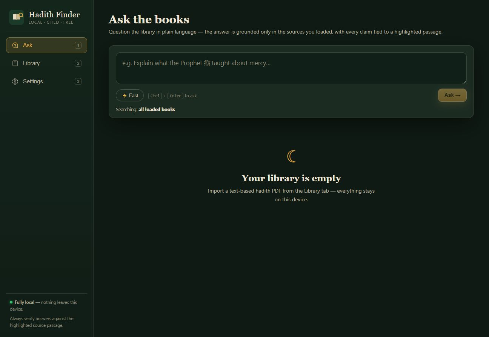
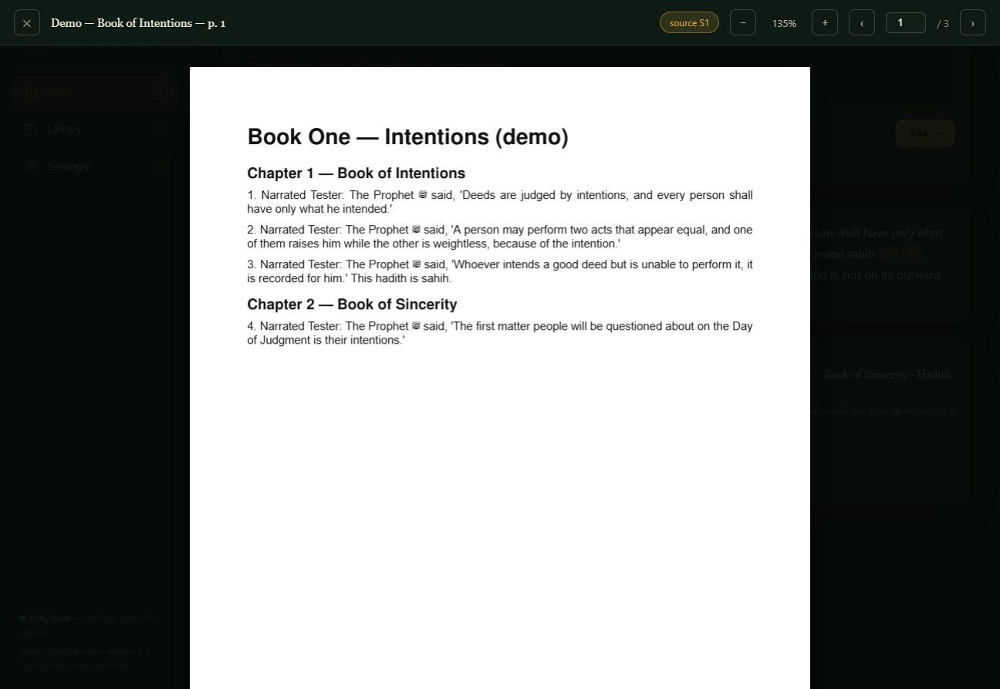
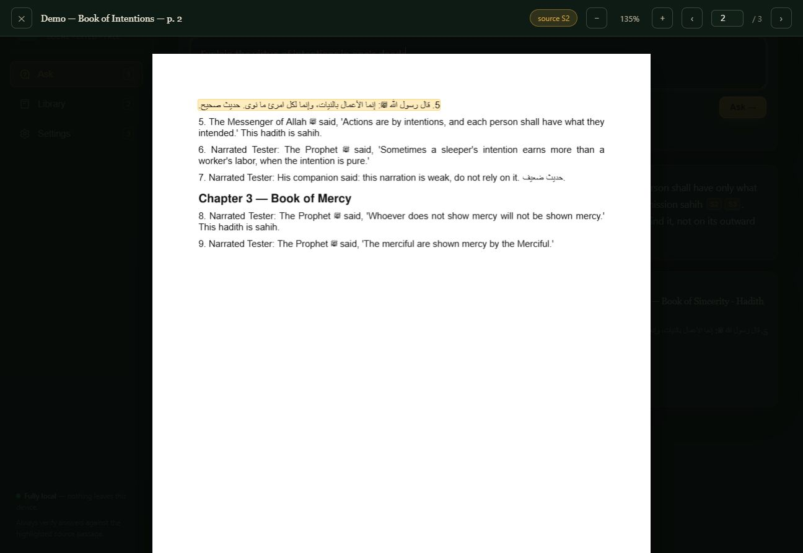

# Hadith Finder

**Ask hadith books questions in plain language — get answers grounded in the exact passage,
with the source highlighted on the page. Fully local, completely free, no accounts.**

Import your own text-based PDF books (Arabic, English, or bilingual editions with both side
by side). Ask things like *“Explain what the Prophet ﷺ taught about mercy”* — and Hadith
Finder points you to the precise passages: page numbers, hadith-style references, and the
text highlighted live in the PDF viewer. When it doesn’t know, it says so — it never invents
a hadith.

> ⚠️ AI can be wrong. Always verify against the highlighted source passage. Hadith Finder
> never issues religious rulings, and authenticity gradings are shown only when the printed
> book states them.

## Why it’s built this way

Accuracy doesn’t come from the model alone. Hadith Finder is a **grounded research pipeline**:

1. **Hadith-aware chunking** — books are split at hadith boundaries (numbering / حَدَّثَنَا
   delimits), not blind fixed windows. Chapter context (كتاب / باب / Book / Chapter) is kept
   with every passage.
2. **Hybrid retrieval** — SQLite FTS5 (BM25, with Arabic normalization: tashkeel stripped,
   alef/ya forms unified) **plus** dense vectors from BGE-M3, fused with Reciprocal Rank
   Fusion (k = 60). Exact names *and* paraphrases, *and* cross-lingual Arabic ↔ English.
3. **Cross-encoder reranking** — bge-reranker-v2-m3 re-scores the top 30 candidates before
   the LLM sees anything. The largest single precision win.
4. **Strictly grounded answers** — the model may only use the retrieved excerpts; inline
   citations `[S1] … [Sn]` map to page numbers + word-level highlight boxes. If the sources
   don’t contain the answer, the reply is exactly *“I could not find this in the loaded
   books.”*
5. **Authenticity as printed** — grading keywords (صحيح / حسن / ضعيف / موضوع, sahih / hasan /
   da’if …) are extracted *only when the book itself states them*, and shown as chips on each
   source card.

## What ships in v0.1

- Import text-based PDFs (Arabic / English / bilingual) — bring-your-own-books. No book
  content is distributed with the app.
- Full-text + semantic hybrid search over your library, with background indexing and
  progress bar.
- Ask view with **Fast / Careful** modes (Careful = step-by-step reasoning), citation chips,
  source cards with scroll/jump.
- Built-in PDF viewer with **highlighted passages**, page jump, arrow-key navigation.
- One-time **AI model download** (~6.2 GB) from Settings with resume support.
- Open source (AGPL-3.0) — share it with anyone, for free.

### Roadmap (next)

- Scanned/image PDFs via OCR (Tesseract)
- Summarize whole books/chapters
- Pre-built, checksum-pinned model manifest; delta indexing
- macOS + Linux builds; Urdu/Turkish UI translations
- Grading sources beyond the book (e.g., cross-book references), always labeled

## AI models (free, open, local)

| Role | Model | License | Size |
|------|-------|---------|------|
| Answers | Qwen3-8B-Instruct (Q4_K_M) | Apache-2.0 | ~4.7 GB |
| Retrieval | BGE-M3 (int8 ONNX) | MIT | ~0.55 GB |
| Reranking | bge-reranker-v2-m3 (int8 ONNX) | MIT | ~0.55 GB |

16 GB RAM is enough; an entry GPU or CPU-only works (slower). Everything runs on-device —
your library never leaves your computer, and it works offline after the one-time download.

## Install (end users)

Download the Windows installer from the Releases page and run it. On first launch, open
**Settings → AI Models** and download the three models (~6.2 GB, once, resumable). Then
**Library → Import PDF**. See [docs/ARCHITECTURE.md](docs/ARCHITECTURE.md) for how it all fits
together.

### Try it with the demo book

A synthetic bilingual demo (invented narrations, no real hadiths) is included at
[`demo/demo-book-of-intentions.pdf`](demo/demo-book-of-intentions.pdf). Import it, then try:

> *Explain the virtue of intentions* → the answer cites S1–S3 with grading chips (sahih where
> the book states it, “no grading printed in this source” where it doesn’t). Press
> **Highlight in book** on any source — the exact Arabic or English passage is highlighted on
> the page.







## Build from source

Prerequisites: **Rust** ≥ 1.85 (with the MSVC toolchain on Windows), **Node** ≥ 20,
**Python** ≥ 3.11, Windows 10/11 with WebView2 (preinstalled on Win10/11).

```bash
git clone <this repo>
cd hadith-finder/app
npm install
npm run tauri dev     # development window
```

Useful environment overrides (dev):

```bash
# use offline stand-ins instead of the real models (tests only):
set HADITH_EMBEDDER=hash && set HADITH_LLM=echo && set HADITH_RERANKER=identity
```

Sidecar tests:

```bash
cd sidecar
py -3.13 -m pip install -r requirements.txt pytest
py -3.13 -m pytest -q
```

## How the highlighting works

At import time every word’s bounding box is stored alongside each passage. Clicking
“Highlight in book” opens the embedded PDF viewer at the cited page and draws highlight
overlays exactly over the cited lines — the same way a scholar would pencil a page.

## Project layout

```
app/            Tauri 2 shell — React + TypeScript UI, Rust core (file IO, IPC, spawn)
  src/          Ask / Library / Settings views, PDF viewer (pdfjs-dist)
  src-tauri/    Rust: sidecar bridge, library path, model commands
sidecar/        Python AI backend (PyMuPDF ingest, hybrid retrieval, llama.cpp chat)
docs/           Architecture and design decisions
LICENSE         AGPL-3.0 (required by PyMuPDF; keeps this app open for everyone)
NOTICE.md       Third-party licenses and attribution
```

## Packaging

```bash
cd app
npm run tauri build   # produces installer + MSI in src-tauri/target/release/bundle/
```

The Python sidecar is compiled to a single `hadith-sidecar.exe` with PyInstaller and bundled
as a Tauri external binary, so users never need Python installed.

## Bring your own books — always

Hadith Finder contains no book content and will never redistribute anyone's text or
translation. Classical Arabic hadith texts are generally public domain; English
translations are frequently copyrighted by their publishers — use copies you're entitled
to keep. This app is a reading aid, not a substitute for a qualified teacher.

## License

AGPL-3.0 — see [LICENSE](LICENSE) and [NOTICE.md](NOTICE.md). Contributions welcome.
